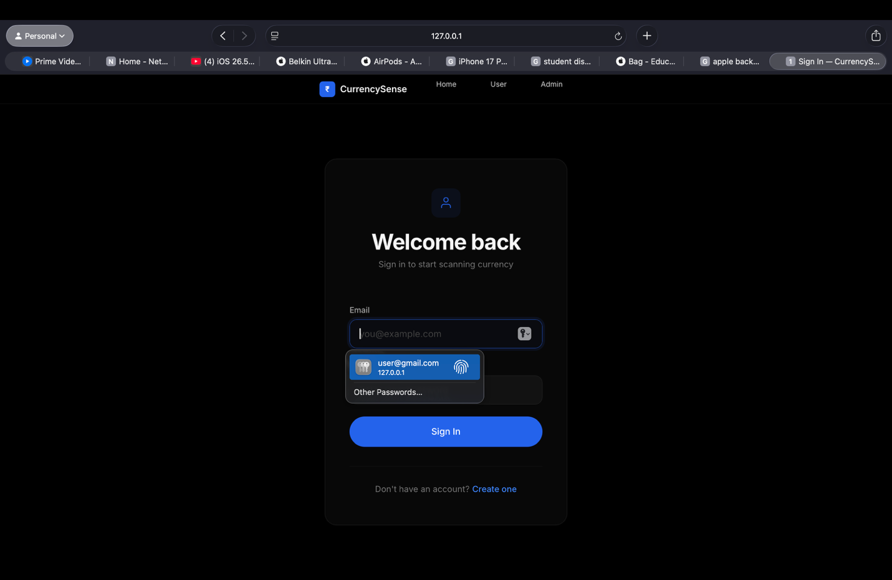
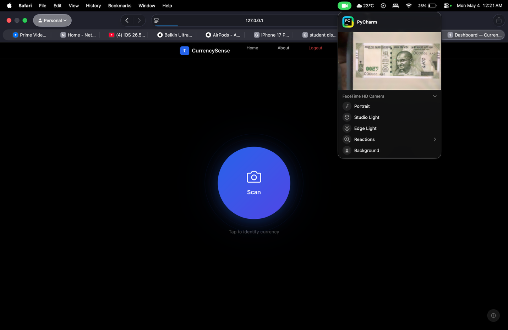
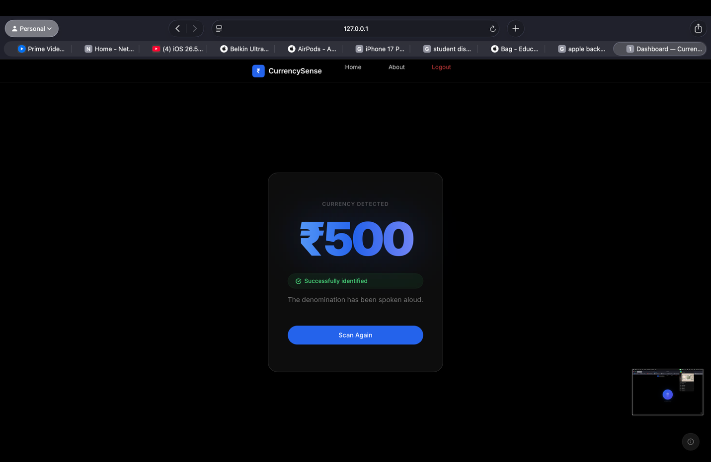
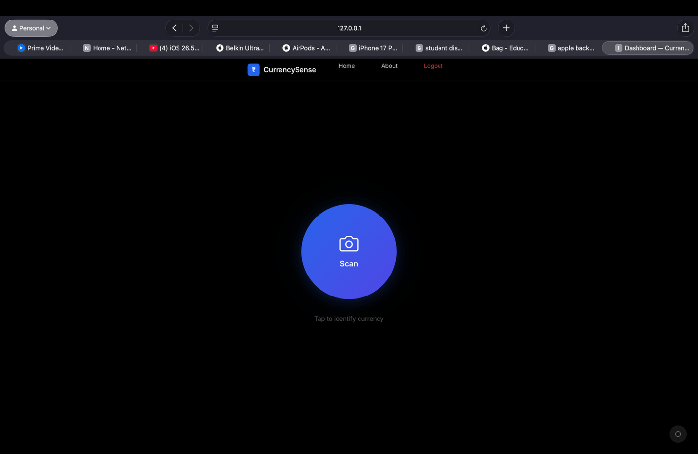
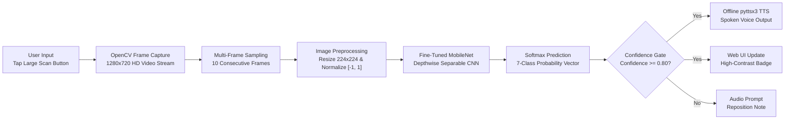
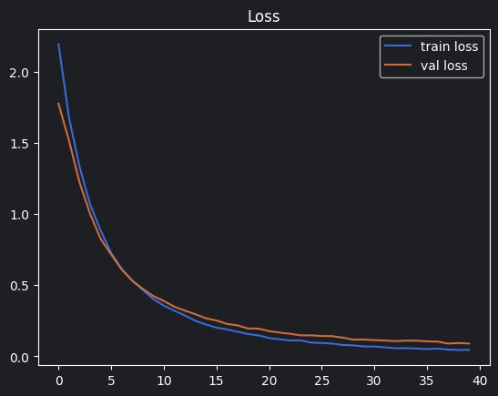
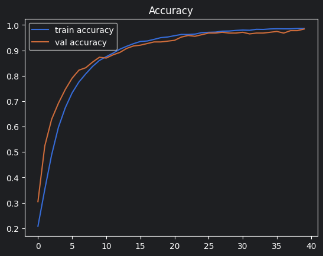

# CurrencySense: Adaptive Currency Recognition for the Blind

<div align="center">

[](https://www.python.org/)
[](https://www.tensorflow.org/)
[](https://www.djangoproject.com/)
[](https://opencv.org/)
[]()
[-blue?style=for-the-badge)]()

**A real-time, edge-deployable assistive computer vision system designed to assist visually impaired individuals in identifying Indian paper currency denominations via live camera capture and immediate spoken audio feedback.**

[Overview](#overview) • [Key Capabilities](#key-capabilities) • [Interface & Demonstrations](#interface--demonstrations) • [System Architecture](#system-architecture) • [Experimental Benchmarks](#experimental-benchmarks) • [Quickstart Guide](#quickstart-guide) • [Repository Structure](#repository-structure)

</div>

---

## Overview

Over 40 million individuals in India live with visual impairments. Daily cash transactions remain indispensable, yet identifying paper currency denominations independently is a persistent challenge. While contemporary banknotes include embossed tactile markers, continuous physical wear, folding, and soiling rapidly degrade these tactile cues.

CurrencySense provides an accessible, non-intrusive solution by turning standard commodity webcams and laptop cameras into automated denomination readers. Operating fully on-device without external cloud dependencies, the system delivers spoken audio announcements in under 1.8 seconds, guaranteeing low latency, data privacy, and reliability in low-connectivity settings.

---

## Key Capabilities

- **Comprehensive Denomination Support:** Classifies all 7 contemporary denominations in the Mahatma Gandhi (New) Series: INR 10, INR 20, INR 50, INR 100, INR 200, INR 500, and INR 2000.
- **High-Accuracy Transfer Learning Backbone:** Leverages an optimized MobileNet architecture utilizing depthwise separable convolutions, achieving 98.41% validation accuracy with minimal computational overhead.
- **Offline Text-to-Speech Feedback:** Directly integrates `pyttsx3` speech synthesis on the host machine to verbalize identified denominations aloud without requiring internet access.
- **Temporal Multi-Frame Averaging:** Samples 10 sequential video frames and applies a confidence threshold filter to prevent erroneous predictions caused by hand motion, blur, or glare.
- **Accessible User Interface:** High-contrast, tactile-focused controls designed in accordance with universal design principles and WCAG accessibility standards.
- **Zero Cloud Dependence:** Complete offline execution ensures user privacy, eliminates recurring API costs, and operates smoothly in disconnected environments.

---

## Interface & Demonstrations

<div align="center">
  <table>
    <tr>
      <td align="center"><b>Accessible Web Landing Interface</b></td>
      <td align="center"><b>High-Contrast Single-Tap Scanner</b></td>
    </tr>
    <tr>
      <td></td>
      <td></td>
    </tr>
    <tr>
      <td align="center"><b>Real-Time Camera Frame Acquisition</b></td>
      <td align="center"><b>User Authentication Gateway</b></td>
    </tr>
    <tr>
      <td></td>
      <td></td>
    </tr>
  </table>
</div>

---

## System Architecture



---

## Experimental Benchmarks

The model was fine-tuned on a dataset of 14,036 currency banknote images across 7 denomination categories, photographed under diverse angles, ambient lighting variations, backgrounds, and physical degradation levels.

<div align="center">
  <table>
    <tr>
      <td align="center"><b>Training and Validation Accuracy Curves</b></td>
      <td align="center"><b>Categorical Cross-Entropy Loss Curves</b></td>
    </tr>
    <tr>
      <td></td>
      <td></td>
    </tr>
  </table>
</div>

### Confusion Matrix

$$\mathbf{C} = \begin{bmatrix}
45 & 0 & 0 & 0 & 0 & 0 & 0 \\
0 & 44 & 0 & 0 & 0 & 0 & 1 \\
0 & 0 & 45 & 0 & 0 & 0 & 0 \\
0 & 0 & 0 & 45 & 0 & 0 & 0 \\
0 & 0 & 0 & 0 & 45 & 0 & 0 \\
0 & 0 & 1 & 1 & 0 & 43 & 0 \\
0 & 1 & 0 & 0 & 0 & 1 & 43
\end{bmatrix}$$

### Per-Class Evaluation Metrics

| Denomination | Precision | Recall | F1-Score | Validation Samples (N) |
|:---|:---:|:---:|:---:|:---:|
| **INR 100 (`1Hundrednote`)** | **1.00** | **1.00** | **1.00** | 45 |
| **INR 200 (`2Hundrednote`)** | **0.98** | **0.98** | **0.98** | 45 |
| **INR 2000 (`2Thousandnote`)** | **0.98** | **1.00** | **0.99** | 45 |
| **INR 500 (`5Hundrednote`)** | **0.98** | **1.00** | **0.99** | 45 |
| **INR 50 (`Fiftynote`)** | **1.00** | **1.00** | **1.00** | 45 |
| **INR 10 (`Tennote`)** | **0.98** | **0.96** | **0.97** | 45 |
| **INR 20 (`Twentynote`)** | **0.98** | **0.96** | **0.97** | 45 |
| **Overall Accuracy** | — | — | **98.41%** | **315** |
| **Macro / Weighted Average** | **0.98** | **0.98** | **0.98** | **315** |

---

## Quickstart Guide

### 1. Prerequisites
- **Operating System:** macOS (Apple Silicon / Intel), Linux (Ubuntu 20.04+), or Windows 10/11
- **Python:** Python 3.8 or 3.9
- **Hardware:** Standard USB or built-in webcam, audio speakers or headphones

### 2. Environment Setup

```bash
# Clone the repository
git clone https://github.com/Akanksh-V/Adaptive-Currency-Recognition-for-the-Blind.git
cd Adaptive-Currency-Recognition-for-the-Blind

# Create and activate virtual environment
python3 -m venv venv

# On macOS and Linux:
source venv/bin/activate
# On Windows:
# venv\Scripts\activate

# Install dependencies
pip install -r requirements.txt
```

### 3. Database Initialization & Execution

```bash
# Apply database migrations
python manage.py migrate

# Launch local server
python manage.py runserver
```

Access the application in any web browser at `http://127.0.0.1:8000`.

### Default Credentials
- **User Portal:** Email: `user@gmail.com` | Password: `user`
- **Admin Portal:** Username: `admin` | Password: `admin`

---

## Model Training and Fine-Tuning Pipeline

To review or modify the model training process:

1. Open `models/MobileNet_FineTuned_98Acc.ipynb` in Jupyter Notebook or your preferred IDE.
2. The transfer learning pipeline loads pre-trained ImageNet weights, preserves early representation layers, unfreezes the deepest 40 convolutional layers, and attaches regularized classifier heads:
   ```
   GlobalAveragePooling2D -> Dense(256, ReLU) -> Dropout(0.5) -> Dense(128, ReLU) -> Dropout(0.3) -> Dense(7, Softmax)
   ```
3. Real-time data augmentation includes affine rotations ($\pm 15^\circ$), zoom ($\pm 15\%$), brightness perturbation ($[0.8, 1.2]$), and width/height shifts.
4. The dataset downloader utility is available at `scripts/setup_dataset.py`.

---

## Repository Structure

```text
├── assets/
│   ├── references/              # Sample test currency images
│   ├── screenshots/             # Interface and performance figures
│   ├── static/css/app.css       # Web UI styling
│   └── templates/user/          # Accessible HTML5 web templates
├── curreny/                     # Django core project configuration
├── docs/                        # Project technical documentation
├── models/
│   ├── MobileNet_FineTuned_98Acc.ipynb  # Primary fine-tuning notebook (98% accuracy)
│   ├── MobileNet.ipynb                  # Baseline MobileNet experiment
│   └── DenseNet.ipynb                   # Baseline DenseNet experiment
├── scripts/
│   └── setup_dataset.py         # Automated dataset download utility
├── user/                        # Web inference, authentication and TTS logic
├── manage.py                    # Django administration script
└── requirements.txt             # Project Python dependencies
```
