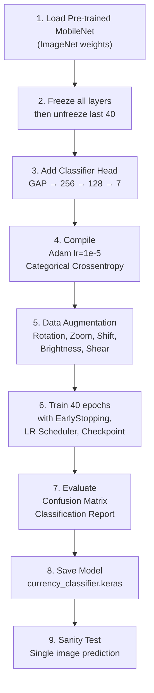

# MobileNet.ipynb — Complete Training File Breakdown

This document explains **every component** of your [MobileNet.ipynb](file:///Users/akankshv/the-blind-assist-main/models/MobileNet.ipynb) training notebook, which trains a currency recognition model for your Blind Assist application.

---

## 1. Imports & Configuration

```python
import os
import numpy as np
import matplotlib.pyplot as plt

from tensorflow.keras.applications import MobileNet
from tensorflow.keras.applications.mobilenet import preprocess_input
from tensorflow.keras.models import Sequential
from tensorflow.keras.layers import Dense, GlobalAveragePooling2D, Dropout
from tensorflow.keras.preprocessing.image import ImageDataGenerator, load_img, img_to_array
from tensorflow.keras.optimizers.legacy import Adam
from tensorflow.keras.callbacks import EarlyStopping, ReduceLROnPlateau, ModelCheckpoint
```

| Import | Purpose |
|--------|---------|
| `os` | File-system path manipulation (`os.path.join`, `os.walk`) |
| `numpy` | Numerical operations — expanding dims, argmax, etc. |
| `matplotlib.pyplot` | Plotting training loss/accuracy curves |
| `MobileNet` | The **pre-trained base model** (trained on ImageNet's 1.2M images). Lightweight CNN designed for mobile/edge devices, using **depthwise separable convolutions** instead of standard convolutions to drastically reduce parameters |
| `preprocess_input` | Normalizes pixel values to the range MobileNet expects (scales pixels to `[-1, 1]`) |
| `Sequential` | Keras API for stacking layers linearly, one after another |
| `Dense` | Fully-connected (linear) layers for the classifier head |
| `GlobalAveragePooling2D` | Reduces each feature map to a single number by averaging, replacing Flatten — fewer parameters, less overfitting |
| `Dropout` | Regularization layer that randomly zeroes out a fraction of neurons during training to prevent overfitting |
| `ImageDataGenerator` | Real-time data augmentation pipeline (rotations, shifts, zooms, etc.) |
| `load_img` / `img_to_array` | Utilities for loading and converting a single image for inference |
| `Adam` (legacy) | Adaptive Moment Estimation optimizer — combines momentum + RMSProp. The `legacy` import is used for Apple Silicon (M1/M2) compatibility |
| `EarlyStopping` | Stops training automatically when val_loss stops improving |
| `ReduceLROnPlateau` | Reduces learning rate when val_loss plateaus |
| `ModelCheckpoint` | Saves the model weights whenever val_loss reaches a new minimum |

### Path Configuration

```python
BASE_DIR = "/Users/akankshv/the-blind-assist-main"
train_path = os.path.join(BASE_DIR, "dataset", "training")
valid_path = os.path.join(BASE_DIR, "dataset", "validation")
IMAGE_SIZE = (224, 224)
```

- **`IMAGE_SIZE = (224, 224)`**: MobileNet's default input resolution. All images are resized to 224×224 pixels.
- The dataset is organized in the **directory structure** expected by `flow_from_directory`: each subfolder name becomes a class label.

---

## 2. Model Architecture (Transfer Learning)

```python
base_model = MobileNet(
    weights='imagenet',
    include_top=False,
    input_shape=(224, 224, 3)
)
```

| Parameter | Meaning |
|-----------|---------|
| `weights='imagenet'` | Load weights pre-trained on ImageNet (1000 classes, 1.2M images). This gives the model a massive head-start — it already knows how to extract edges, textures, shapes, etc. |
| `include_top=False` | **Remove** the original 1000-class classifier head. You'll attach your own 7-class head for currency notes |
| `input_shape=(224, 224, 3)` | Expect 224×224 RGB images |

### Layer Freezing Strategy (Fine-Tuning)

```python
# Freeze all layers
for layer in base_model.layers:
    layer.trainable = False

# Unfreeze deeper layers
for layer in base_model.layers[-40:]:
    layer.trainable = True
```

This implements a **partial fine-tuning** strategy:

1. **First**: Freeze **all** MobileNet layers (their weights won't change during training)
2. **Then**: Un-freeze the **last 40 layers** — these are the deeper, more abstract feature extractors

> [!IMPORTANT]
> **Why this approach?** Earlier layers capture universal features (edges, textures) that transfer well to any image task. Deeper layers capture task-specific features. By only training the last 40 layers, you adapt the model to currency recognition while preserving the general-purpose features — this is much faster and more data-efficient than training from scratch.

### Custom Classifier Head

```python
Classifier = Sequential([
    base_model,
    GlobalAveragePooling2D(),

    Dense(256, activation='relu'),
    Dropout(0.5),

    Dense(128, activation='relu'),
    Dropout(0.3),

    Dense(7, activation='softmax')
])
```

This builds a **Sequential stack** on top of MobileNet:

| Layer | What it does |
|-------|-------------|
| `base_model` | Feature extractor — outputs a 7×7×1024 tensor (for 224×224 input) |
| `GlobalAveragePooling2D()` | Averages each of the 1024 feature maps → produces a 1024-dim vector. This is preferred over `Flatten()` because it reduces parameters dramatically and acts as a structural regularizer |
| `Dense(256, relu)` | First fully-connected layer with 256 neurons and ReLU activation (`max(0, x)` — introduces non-linearity) |
| `Dropout(0.5)` | During training, randomly sets **50%** of neurons to zero at each step. Forces redundancy in learned features → reduces overfitting |
| `Dense(128, relu)` | Second fully-connected layer with 128 neurons |
| `Dropout(0.3)` | **30%** dropout — lighter regularization in this layer |
| `Dense(7, softmax)` | **Output layer** — 7 neurons for 7 currency classes. `softmax` converts raw scores into probabilities that sum to 1.0 |

> [!NOTE]
> **The 7 classes** correspond to Indian currency denominations: ₹10, ₹20, ₹50, ₹100, ₹200, ₹500, ₹2000.

---

## 3. Compilation

```python
Classifier.compile(
    loss='categorical_crossentropy',
    optimizer=Adam(learning_rate=1e-5),
    metrics=['accuracy']
)
```

| Parameter | Meaning |
|-----------|---------|
| `loss='categorical_crossentropy'` | Standard loss function for **multi-class** classification when labels are one-hot encoded. Measures the difference between predicted probability distribution and the true distribution. Penalizes confident wrong predictions heavily |
| `optimizer=Adam(learning_rate=1e-5)` | Adam optimizer with a **very small** learning rate (`0.00001`). This is critical for fine-tuning — large learning rates would destroy the pre-trained weights |
| `metrics=['accuracy']` | Track classification accuracy during training |

---

## 4. Data Generators (Augmentation)

### Training Generator

```python
train_datagen = ImageDataGenerator(
    preprocessing_function=preprocess_input,
    rotation_range=15,
    zoom_range=0.15,
    width_shift_range=0.1,
    height_shift_range=0.1,
    brightness_range=[0.8, 1.2],
    shear_range=0.1
)
```

This applies **real-time data augmentation** to training images:

| Augmentation | Effect |
|--------------|--------|
| `preprocessing_function=preprocess_input` | Scales pixel values to `[-1, 1]` (MobileNet's expected range) |
| `rotation_range=15` | Random rotation up to ±15° — simulates tilted camera |
| `zoom_range=0.15` | Random zoom in/out up to 15% — simulates varying distances |
| `width_shift_range=0.1` | Horizontal shift up to 10% of width — simulates off-center framing |
| `height_shift_range=0.1` | Vertical shift up to 10% of height |
| `brightness_range=[0.8, 1.2]` | Random brightness variation (80%–120%) — simulates different lighting |
| `shear_range=0.1` | Shearing transformation up to 10% — simulates perspective distortion |

> [!TIP]
> **Why augment?** Each epoch, the model sees slightly different versions of the same images. This artificially increases dataset diversity, making the model robust to real-world variations (different lighting, angles, distances) without needing to collect more data.

### Validation Generator

```python
valid_datagen = ImageDataGenerator(
    preprocessing_function=preprocess_input
)
```

- **No augmentation** on validation data — only preprocessing.
- Validation must reflect real-world conditions to give an honest accuracy estimate.

### Flow from Directory

```python
training_set = train_datagen.flow_from_directory(
    train_path,
    target_size=IMAGE_SIZE,
    batch_size=32,
    class_mode='categorical'
)

validation_set = valid_datagen.flow_from_directory(
    valid_path,
    target_size=IMAGE_SIZE,
    batch_size=32,
    class_mode='categorical',
    shuffle=False  # VERY IMPORTANT FIX
)
```

| Parameter | Meaning |
|-----------|---------|
| `target_size=IMAGE_SIZE` | Resize all images to 224×224 |
| `batch_size=32` | Feed 32 images at a time to the model (a balance between speed and memory) |
| `class_mode='categorical'` | One-hot encode labels (e.g., ₹100 → `[1,0,0,0,0,0,0]`) |
| `shuffle=False` (validation only) | **Critical** — keeps validation images in order so the confusion matrix and classification report correctly map predictions to true labels |

---

## 5. Callbacks

```python
early_stop = EarlyStopping(
    monitor='val_loss',
    patience=6,
    restore_best_weights=True
)
```

- **Watches** `val_loss` (validation loss)
- If val_loss doesn't improve for **6 consecutive epochs**, training stops
- **`restore_best_weights=True`**: After stopping, the model reverts to the weights from the best epoch (not the last)

```python
lr_scheduler = ReduceLROnPlateau(
    monitor='val_loss',
    factor=0.3,
    patience=3,
    min_lr=1e-6,
    verbose=1
)
```

- If val_loss doesn't improve for **3 epochs**, multiply the learning rate by **0.3** (e.g., `1e-5 → 3e-6`)
- Won't go below `1e-6`
- This helps the model escape plateaus by taking smaller steps

```python
checkpoint = ModelCheckpoint(
    "best_model.keras",
    monitor="val_loss",
    save_best_only=True,
    verbose=1
)
```

- Saves the model to `best_model.keras` every time `val_loss` reaches a **new minimum**
- Acts as an insurance policy — even if training crashes, you have the best model saved

---

## 6. Training

```python
history = Classifier.fit(
    training_set,
    validation_data=validation_set,
    epochs=40,
    callbacks=[early_stop, lr_scheduler, checkpoint]
)
```

- Trains for up to **40 epochs** (full passes through the training data)
- Each epoch processes **426 batches** (426 × 32 = ~13,632 training images)
- The `history` object stores loss/accuracy values for each epoch (used for plotting)

### Training Progression (from logs)

| Epoch | Train Loss | Train Acc | Val Loss | Val Acc |
|-------|-----------|-----------|----------|---------|
| 2 | 1.6750 | 35.3% | 1.5132 | 52.4% |
| 10 | 0.4029 | 86.0% | 0.4235 | 87.3% |
| 20 | 0.1470 | 95.3% | 0.1941 | 93.7% |
| 30 | 0.0694 | 97.9% | 0.1180 | 96.8% |
| 38 | 0.0474 | 98.5% | **0.0895** | **97.8%** |
| 40 | 0.0453 | 98.6% | 0.0897 | 98.4% |

> [!NOTE]
> The best model was saved at **epoch 38** (`val_loss = 0.0895`). EarlyStopping didn't trigger because the model kept improving (or at least not deteriorating for 6 consecutive epochs).

---

## 7. Visualization (Loss & Accuracy Plots)

```python
plt.plot(history.history['loss'], label='train loss')
plt.plot(history.history['val_loss'], label='val loss')

plt.plot(history.history['accuracy'], label='train accuracy')
plt.plot(history.history['val_accuracy'], label='val accuracy')
```

Two plots are generated:
1. **Loss curve**: Shows training and validation loss decreasing over epochs. If val_loss diverges upward while train_loss keeps dropping → overfitting
2. **Accuracy curve**: Shows both accuracies converging toward ~98%

The curves indicate **healthy training** — no significant overfitting gap between train and validation.

---

## 8. Model Saving

```python
save_path = os.path.join(BASE_DIR, "currency_classifier.keras")
Classifier.save(save_path)
```

Saves the **final model** (with last-epoch weights) in Keras native format (`.keras`). This is the file your web application loads for inference.

> [!NOTE]
> Note: This saves the final model, not necessarily the best one. The best model is separately saved as `best_model.keras` by the `ModelCheckpoint` callback.

---

## 9. Evaluation — Confusion Matrix & Classification Report

```python
from sklearn.metrics import confusion_matrix, classification_report

validation_set.reset()
y_pred = Classifier.predict(validation_set)
y_pred_classes = np.argmax(y_pred, axis=1)
y_true = validation_set.classes

cm = confusion_matrix(y_true, y_pred_classes)
print(classification_report(y_true, y_pred_classes,
    target_names=list(training_set.class_indices.keys())))
```

### What each step does:

1. **`validation_set.reset()`** — Resets the generator to the beginning so predictions align with labels
2. **`Classifier.predict()`** — Generates probability vectors for all validation images
3. **`np.argmax(y_pred, axis=1)`** — Converts probability vectors to class indices (picks the highest probability)
4. **`validation_set.classes`** — Gets the true labels (this only works correctly because `shuffle=False`)

### Results — Confusion Matrix

```
[[45  0  0  0  0  0  0]    ← ₹100: 45/45 correct
 [ 0 44  0  0  0  0  1]    ← ₹200: 44/45 correct (1 confused with ₹20)
 [ 0  0 45  0  0  0  0]    ← ₹2000: 45/45 correct
 [ 0  0  0 45  0  0  0]    ← ₹500: 45/45 correct
 [ 0  0  0  0 45  0  0]    ← ₹50: 45/45 correct
 [ 0  0  1  1  0 43  0]    ← ₹10: 43/45 correct (1 confused with ₹2000, 1 with ₹500)
 [ 0  1  0  0  0  1 43]]   ← ₹20: 43/45 correct (1 confused with ₹200, 1 with ₹10)
```

### Classification Report

| Class | Precision | Recall | F1-Score |
|-------|-----------|--------|----------|
| ₹100 | 1.00 | 1.00 | 1.00 |
| ₹200 | 0.98 | 0.98 | 0.98 |
| ₹2000 | 0.98 | 1.00 | 0.99 |
| ₹500 | 0.98 | 1.00 | 0.99 |
| ₹50 | 1.00 | 1.00 | 1.00 |
| ₹10 | 0.98 | 0.96 | 0.97 |
| ₹20 | 0.98 | 0.96 | 0.97 |
| **Overall** | **0.98** | **0.98** | **0.98** |

> [!TIP]
> **Precision** = Of all predicted as class X, how many were truly X?  
> **Recall** = Of all actual class X images, how many were correctly identified?  
> **F1-Score** = Harmonic mean of precision and recall (balances both).

---

## 10. Sanity Test (Single Image Inference)

```python
class_labels = {v: k for k, v in training_set.class_indices.items()}

# Find a test image from training set
for root, dirs, files in os.walk(train_path):
    for file in files:
        if file.lower().endswith((".jpg", ".png", ".jpeg")):
            test_image_path = os.path.join(root, file)
            break

# Preprocess and predict
img = load_img(test_image_path, target_size=IMAGE_SIZE)
img_array = img_to_array(img)
img_array = preprocess_input(img_array)
img_array = np.expand_dims(img_array, axis=0)

pred = Classifier.predict(img_array)
predicted_class = np.argmax(pred)
confidence = np.max(pred)
```

### Step-by-step:

1. **`class_labels`** — Inverts the `class_indices` dict so you can map index → label name
2. **`os.walk()`** — Walks through the training directory to find the first `.jpg`/`.png`/`.jpeg` file
3. **`load_img()`** — Loads the image and resizes to 224×224
4. **`img_to_array()`** — Converts PIL Image to numpy array (shape: `224, 224, 3`)
5. **`preprocess_input()`** — Scales pixels to `[-1, 1]`
6. **`np.expand_dims()`** — Adds batch dimension (shape: `1, 224, 224, 3`) — the model expects batches
7. **`predict()`** — Returns a 7-element probability vector
8. **`argmax` / `max`** — Gets the predicted class index and its confidence score

### Result:
```
Testing: .../dataset/training/5Hundrednote/500__238.jpg
Prediction: 5Hundrednote
Confidence: 0.9997886
```

The model correctly identified a ₹500 note with **99.98% confidence**.

---

## Summary — Full Pipeline



The model achieves **98% accuracy** across all 7 Indian currency denominations, with only 5 misclassifications out of 315 validation images.
