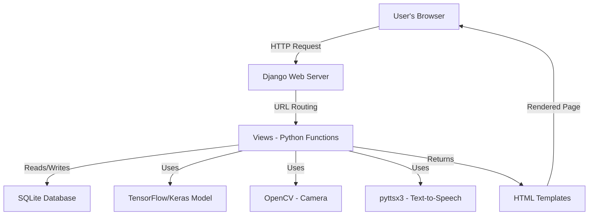
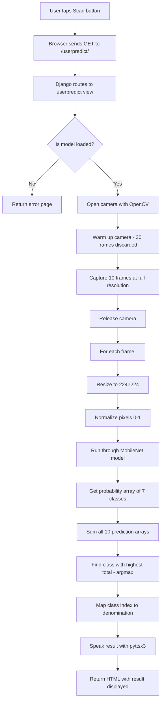

# 🧠 Key Concepts — CurrencySense (Blind Assist)

These notes explain **every key concept** used in your project in a simple, digestible way. Read them section by section.

---

## 1. What Does This Project Do? (Big Picture)

Your project is a **web application that recognizes Indian currency notes using a camera and speaks the denomination aloud** for visually impaired users.

The flow is:

```
User taps "Scan"
    → Camera captures 10 frames of the currency note
    → Each frame is fed into a trained Deep Learning model
    → Model predicts which note it is (₹10, ₹20, ₹50, ₹100, ₹200, ₹500, ₹2000)
    → Predictions are averaged for accuracy
    → The result is spoken aloud using Text-to-Speech
    → The result is also shown on screen
```

---

## 2. Project Architecture Overview



Your project has **4 main technology pillars**:

| Pillar | Technology | Purpose |
|--------|-----------|---------|
| **Web Framework** | Django | Handles web pages, user login, routing |
| **Deep Learning** | TensorFlow + Keras | Trained CNN model that classifies currency |
| **Computer Vision** | OpenCV | Captures images from the camera |
| **Accessibility** | pyttsx3 | Speaks the result aloud |

---

## 3. Django Web Framework

### 3.1 What is Django?

Django is a **Python web framework** — it's a collection of tools that makes it easy to build websites with Python. Think of it as a pre-built skeleton for a web app.

### 3.2 The MVT Pattern

Django follows the **Model-View-Template (MVT)** pattern. This is a way of organizing your code into 3 responsibilities:

| Component | What it does | Your file |
|-----------|-------------|-----------|
| **Model** | Defines the shape of your data (what gets stored in the database) | `user/models.py` |
| **View** | Contains the logic — what happens when a user visits a page | `user/views.py`, `curreny/views.py` |
| **Template** | The HTML pages the user actually sees | `assets/templates/*.html` |

**Analogy**: Think of a restaurant 🍽️
- **Model** = The menu (defines what items exist)
- **View** = The chef (processes the order and prepares the food)
- **Template** = The plate (presents the food to the customer)

### 3.3 URL Routing (`urls.py`)

When a user types a URL (like `/userpredict/`), Django needs to know **which Python function to run**. That mapping is done in `urls.py`:

```python
path('userpredict/', usr.userpredict, name='userpredict')
#     ↑ URL path       ↑ function        ↑ nickname for use in templates
```

This says: *"When someone visits `/userpredict/`, run the `userpredict` function from `user/views.py`."*

Your project has routes for:
- Landing page (`/`)
- User login, signup, logout
- Admin login, dashboard
- Currency prediction (`/userpredict/`)
- Info page (`/userinfo/`)

### 3.4 Models & ORM (`models.py`)

A **Model** is a Python class that represents a database table. Each attribute = one column.

```python
class UserModel(models.Model):
    username = models.CharField(max_length=100)   # text column
    email    = models.EmailField()                 # email column
    password = models.CharField(max_length=100)    # text column
    mobile   = models.CharField(max_length=100)
    city     = models.CharField(max_length=100)
    state    = models.CharField(max_length=100)
```

This creates a table called `user` in the SQLite database with those 6 columns.

**ORM (Object-Relational Mapping)** means you interact with the database using Python objects instead of writing raw SQL:

```python
# Creating a new user (instead of writing INSERT INTO...)
Details = UserModel(username='Akanksh', email='a@b.com', ...)
Details.save()

# Finding a user (instead of writing SELECT * FROM...)
UserModel.objects.get(email='a@b.com', password='mypass')
```

### 3.5 Views (`views.py`)

A **view** is just a Python function that:
1. Receives an **HTTP request** (from the user's browser)
2. Does some **processing** (login check, run prediction, etc.)
3. Returns an **HTTP response** (usually an HTML page)

```python
def userhome(request):
    return render(request, 'user/userhome.html')
#                          ↑ which HTML template to show
```

For the prediction view, it does much more — captures images, runs the model, speaks the result, and returns the result to the template.

### 3.6 Templates (HTML files)

Templates are HTML files with **Django template tags** — special placeholders that get filled in with data:

```html

    <div class="result-amount">₹{{ result }}</div>

```

| Syntax | Meaning |
|--------|---------|
| `{{ variable }}` | Print a variable's value |
| `` | Conditional logic |
| `` | Inherit layout from a parent template |
| `` | Define a replaceable section |
| `` | Generate a URL by its name |
| `` | Enable static file loading |

**Template Inheritance**: Your templates use a parent-child system:
- `userbase.html` → defines the common layout (navbar, footer, CSS)
- `userhome.html` → extends it and fills in just the page-specific content

### 3.7 Static & Media Files

| Type | What | Directory | Setting |
|------|------|-----------|---------|
| **Static** | CSS, JS, images that never change | `assets/static/` | `STATIC_URL = '/static/'` |
| **Media** | User-uploaded or runtime files (captured camera images) | `media/` | `MEDIA_URL = '/media/'` |

### 3.8 SQLite Database

SQLite is a **lightweight, file-based database**. Your entire database lives in one file: `db.sqlite3`. No separate database server needed — perfect for small projects.

### 3.9 `settings.py` — The Control Panel

This file is the **central configuration** for your Django project. Key settings:

| Setting | What it controls |
|---------|-----------------|
| `SECRET_KEY` | Cryptographic signing (security) |
| `DEBUG = True` | Enables detailed error pages (turn off in production!) |
| `INSTALLED_APPS` | Which Django apps are active |
| `DATABASES` | Which database to use (SQLite here) |
| `TEMPLATES.DIRS` | Where to find HTML templates |
| `STATICFILES_DIRS` | Where to find CSS/JS files |

### 3.10 `manage.py` — The Command Center

This is Django's CLI tool. You run commands through it:

```bash
python manage.py runserver     # Start the dev server
python manage.py makemigrations # Create database migration files
python manage.py migrate       # Apply migrations to the database
```

---

## 4. Deep Learning & CNNs

### 4.1 What is Deep Learning?

Deep learning is a subset of Machine Learning that uses **neural networks with many layers** to learn patterns from data. Instead of you writing rules like "if the note is green, it's ₹500", the model **learns the rules itself** from thousands of example images.

```
Traditional Programming:  Rules + Data → Answer
Deep Learning:            Data + Answers → Rules (the model learns them)
```

### 4.2 What is a Neural Network?

A neural network is inspired by the human brain. It's made of **layers of neurons (nodes)** connected together:

```
Input Layer → Hidden Layer 1 → Hidden Layer 2 → ... → Output Layer
(image)        (learns edges)   (learns shapes)        (₹10, ₹50, etc.)
```

Each connection has a **weight** (a number). During training, these weights are adjusted so the network gets better at making predictions.

### 4.3 What is a CNN (Convolutional Neural Network)?

A CNN is a special type of neural network designed specifically for **images**. It uses a technique called **convolution** to detect features in images.

**How convolution works (simplified)**:
1. A small filter (e.g., 3×3 grid) slides across the image
2. At each position, it multiplies the filter values with the pixel values and sums them up
3. This produces a **feature map** — highlighting where certain patterns (edges, textures, shapes) appear

```
Layer 1: Detects edges (horizontal, vertical, diagonal)
Layer 2: Detects textures (patterns, gradients)
Layer 3: Detects parts (numbers, symbols on the note)
Layer 4: Detects objects (the entire currency note denomination)
```

**Key CNN layers used in your project:**

| Layer | What it does |
|-------|-------------|
| `Conv2D` | Applies convolution filters to detect features |
| `MaxPooling2D` | Shrinks the feature map, keeping only the strongest signals |
| `Flatten` | Converts 2D feature maps into a 1D vector |
| `Dense` | A regular fully-connected layer for classification |
| `GlobalAveragePooling2D` | Averages each feature map into a single number (more efficient than Flatten) |
| `Dropout` | Randomly turns off neurons during training to prevent overfitting |
| `Softmax` | Converts output into probabilities that sum to 1 |

### 4.4 Transfer Learning

> [!IMPORTANT]
> This is the single most important concept in your ML pipeline.

**Problem**: Training a CNN from scratch needs millions of images and days of compute.

**Solution**: Take a model that was **already trained on millions of images** (ImageNet — 14M images, 1000 categories) and **reuse its learned knowledge** for your specific task.

**Analogy**: Instead of teaching someone vision from birth, you take someone who already knows how to see, and just teach them to recognize Indian currency notes. 🧠

**How it works in your project:**

```python
# Step 1: Load a pre-trained model (already knows how to "see")
base_model = MobileNet(weights='imagenet', include_top=False)

# Step 2: Freeze its layers (don't change what it already learned)
for layer in base_model.layers:
    layer.trainable = False

# Step 3: Add your own classification layers on top
Classifier = Sequential([
    base_model,                            # Pre-trained feature extractor
    GlobalAveragePooling2D(),              # Compress features
    Dense(256, activation='relu'),         # Learn currency-specific patterns
    Dense(7, activation='softmax')         # Output: 7 currency classes
])
```

### 4.5 MobileNet (Your Primary Model)

MobileNet is a **lightweight CNN** developed by Google, designed to run efficiently on mobile devices.

**Key features:**
- Uses **depthwise separable convolutions** — a trick that reduces computation by ~8-9x compared to regular convolutions
- Only ~4.2M parameters (vs. ~138M in VGG16)
- Fast inference while maintaining good accuracy

**In your project**: MobileNet is used as the **feature extractor** (the "eyes"). Your custom layers on top (Dense 256 → Dense 128 → Dense 7) are the "brain" that decides which note it is.

**Fine-tuning**: You also unfreeze the last 40 layers of MobileNet (`layer.trainable = True`), allowing them to adapt to currency-specific features during training.

### 4.6 DenseNet121 (Alternative Model)

DenseNet (Dense Convolutional Network) is another architecture explored in your project.

**Key idea**: In a DenseNet, every layer is connected to every other layer in a feed-forward fashion. Each layer receives feature maps from **all preceding layers**.

```
Layer 1 → Layer 2
Layer 1 → Layer 3, Layer 2 → Layer 3
Layer 1 → Layer 4, Layer 2 → Layer 4, Layer 3 → Layer 4
```

**Benefits:**
- Stronger feature reuse (doesn't forget early features)
- Fewer parameters needed
- Reduces vanishing gradient problem

**121** refers to 121 layers deep. In your project, this was used with all base layers frozen (no fine-tuning).

### 4.7 Image Preprocessing

Before feeding an image to the model, it needs to be **preprocessed** (cleaned up and standardized):

```python
# 1. Resize to 224×224 pixels (the size MobileNet expects)
test_img = image.load_img(img_path, target_size=(224, 224))

# 2. Convert to a NumPy array of numbers
test_img = image.img_to_array(test_img)

# 3. Normalize pixel values from 0-255 to 0-1
test_img = test_img / 255.0

# 4. Add a batch dimension (model expects batches)
test_img = np.expand_dims(test_img, axis=0)
# Shape goes from (224, 224, 3) to (1, 224, 224, 3)
```

**Why normalize?** Neural networks work better with small numbers. Pixel values of 0-255 would make the math unstable; 0-1 keeps things stable.

### 4.8 Data Augmentation

**Problem**: You don't have millions of currency images.

**Solution**: Artificially create more training data by applying random transformations to existing images:

```python
train_datagen = ImageDataGenerator(
    rotation_range=15,         # Rotate up to 15°
    zoom_range=0.15,           # Zoom in/out by 15%
    width_shift_range=0.1,     # Shift left/right by 10%
    height_shift_range=0.1,    # Shift up/down by 10%
    brightness_range=[0.8, 1.2], # Adjust brightness
    shear_range=0.1            # Slant the image slightly
)
```

This teaches the model to recognize notes even when they're tilted, zoomed, or in different lighting — mimicking real-world conditions.

### 4.9 Training Concepts

#### Loss Function: `categorical_crossentropy`
Measures **how wrong** the model's predictions are. Lower = better. "Categorical" because we have 7 categories (₹10, ₹20, ..., ₹2000).

#### Optimizer: `Adam`
The algorithm that **adjusts the weights** to reduce the loss. Adam is popular because it adapts the learning rate for each weight individually.

#### Learning Rate
How big each adjustment step is. Too large = overshoots the answer. Too small = takes forever.

```python
optimizer = Adam(learning_rate=1e-5)  # 0.00001 — very small, careful steps
```

#### Epochs
One epoch = the model sees the **entire training dataset once**. Your MobileNet trains for up to 40 epochs.

#### Batch Size
How many images the model processes at once before updating weights. Your project uses **32** images per batch.

### 4.10 Callbacks (Training Helpers)

Callbacks are functions that run **during training** at certain points:

| Callback | What it does |
|----------|-------------|
| `EarlyStopping` | Stops training if validation loss hasn't improved for 6 epochs (prevents wasting time) |
| `ReduceLROnPlateau` | If the model is stuck, automatically reduces the learning rate to take smaller steps |
| `ModelCheckpoint` | Saves the best model (lowest validation loss) to a file during training |

### 4.11 Evaluation Metrics

#### Confusion Matrix
A table showing what the model predicted vs. the actual class. Helps you see which notes the model confuses with each other.

#### Classification Report
Shows precision, recall, and F1-score for each class:
- **Precision**: Of all predictions for "₹100", how many were actually ₹100?
- **Recall**: Of all actual ₹100 notes, how many did the model correctly identify?
- **F1-Score**: The harmonic mean of precision and recall (balances both)

---

## 5. OpenCV (Computer Vision)

### 5.1 What is OpenCV?

OpenCV (Open Source Computer Vision Library) is a library for **image and video processing**. In your project, it's used to **capture images from the camera**.

### 5.2 Camera Capture Pipeline

```python
# 1. Open the camera (0 = default/built-in camera)
cam = cv2.VideoCapture(0)

# 2. Set resolution to 1280×720 (HD)
cam.set(cv2.CAP_PROP_FRAME_WIDTH, 1280)
cam.set(cv2.CAP_PROP_FRAME_HEIGHT, 720)

# 3. Warm-up phase — discard first 30 frames
#    (cameras need time to adjust exposure/white balance)
for _ in range(30):
    cam.read()

# 4. Capture 10 frames with 0.2s gaps
for i in range(10):
    ret, frame = cam.read()           # ret=True if frame captured
    cv2.imwrite(f'img{i}.jpg', frame) # Save to disk

# 5. Release the camera
cam.release()
```

**Why 10 frames?** Taking multiple shots and averaging predictions reduces the chance of a single bad frame ruining the result. This is called **ensemble prediction**.

---

## 6. pyttsx3 (Text-to-Speech)

### 6.1 What is pyttsx3?

pyttsx3 is a **text-to-speech library** that works **offline** — no internet required. It uses the operating system's built-in speech engine.

### 6.2 How It's Used

```python
engine = pyttsx3.init()                        # Initialize the engine
engine.say("You have 500 rupees note")         # Queue the text
engine.runAndWait()                            # Speak it out loud
engine.stop()                                  # Clean up
```

This is the **accessibility core** of the project — it's what makes the app usable for blind users. They don't need to read the screen; the answer is spoken aloud.

---

## 7. NumPy

### 7.1 What is NumPy?

NumPy is the fundamental library for **numerical computing** in Python. It provides the `ndarray` — a fast, multi-dimensional array.

### 7.2 How It's Used in Your Project

```python
# Images are represented as NumPy arrays
# A 224×224 color image = array of shape (224, 224, 3)
#                                        height, width, RGB channels

# Normalizing pixel values
test_img = test_img / 255.0

# Finding the predicted class (index of highest probability)
final_class = np.argmax(avg_pred)
# e.g., avg_pred = [0.01, 0.02, 0.05, 0.8, 0.1, 0.01, 0.01]
#        argmax → 3 (index of 0.8) → maps to "₹500"

# Adding a dimension for batch processing
test_img = np.expand_dims(test_img, axis=0)
```

---

## 8. The Prediction Pipeline (End-to-End)

Here's exactly what happens when a user taps "Scan", step by step:



### The Prediction Averaging Strategy

Instead of just using one frame, the model averages predictions across 10 frames:

```python
# Frame 1 prediction: [0.05, 0.02, 0.01, 0.80, 0.10, 0.01, 0.01]
# Frame 2 prediction: [0.03, 0.01, 0.02, 0.85, 0.07, 0.01, 0.01]
# ...
# Frame 10 prediction:[0.04, 0.03, 0.01, 0.82, 0.08, 0.01, 0.01]
#
# Sum them all up, then argmax → more robust final answer
```

This is a simple form of **ensemble averaging** — multiple predictions are more reliable than one.

### The Label Map

```python
label_map = {
    0: '100',    # Class 0 = ₹100
    1: '200',    # Class 1 = ₹200
    2: '2000',   # Class 2 = ₹2000
    3: '500',    # Class 3 = ₹500
    4: '50',     # Class 4 = ₹50
    5: '10',     # Class 5 = ₹10
    6: '20'      # Class 6 = ₹20
}
```

This mapping comes from the **alphabetical order** of your training dataset folder names (how `ImageDataGenerator` assigns class indices).

---

## 9. Authentication System

Your project has a simple authentication system:

### User Flow
1. **Register** → `usersignup` view saves user details to `UserModel` table
2. **Login** → `userloginaction` view checks email + password against the database
3. **Logout** → `userlogout` just redirects to the login page

### Admin Flow
1. **Login** → Hardcoded credentials: `admin` / `admin`
2. **Dashboard** → Can view all registered users
3. **Logout** → Redirects to admin login

> [!NOTE]
> This is a simplified auth system. Passwords are stored in plain text (not hashed), and there are no sessions. In a production app, you'd use Django's built-in `auth` system with hashed passwords and session management.

---

## 10. Frontend Technologies

### Bootstrap
A CSS framework providing pre-built responsive components (grid, buttons, navbar). Your project includes `bootstrap.min.js` and `bootstrap.min.css`.

### Django Template Language
Server-side rendering — the server fills in the HTML with data before sending it to the browser. The user never sees `{{ result }}`; they see the actual value.

### Accessibility (ARIA)
Your templates include ARIA attributes for screen readers:
```html
<div role="status" aria-live="polite" aria-label="Scanning currency note">
```
- `role="status"` → tells screen readers this is a status message
- `aria-live="polite"` → screen reader announces changes without interrupting
- `aria-label` → provides a text description for non-visual users

---

## 11. File & Directory Structure Summary

```
the-blind-assist-main/
├── manage.py                    # Django CLI entry point
├── requirements.txt             # Python dependencies
├── db.sqlite3                   # SQLite database file
├── currency_classifier.keras    # Trained MobileNet model (used in production)
├── currency_classifier.h5       # Older model format
│
├── curreny/                     # Django project config (note: typo in name)
│   ├── settings.py              # Central configuration
│   ├── urls.py                  # URL → view mapping
│   ├── views.py                 # Admin + landing page views
│   └── wsgi.py                  # Web server interface
│
├── user/                        # Django app for user features
│   ├── models.py                # UserModel database definition
│   ├── views.py                 # Login, signup, prediction logic
│   └── migrations/              # Database schema changes
│
├── assets/
│   ├── static/                  # CSS & JavaScript files
│   │   ├── css/
│   │   └── js/
│   └── templates/               # HTML templates
│       ├── index.html           # Landing page
│       ├── base.html            # Base layout
│       ├── user/                # User-facing pages
│       └── admin/               # Admin pages
│
├── models/                      # ML training notebooks
│   ├── MobileNet.ipynb          # MobileNet training code
│   ├── DenseNet.ipynb           # DenseNet training code
│   └── classifiers/             # Saved model files
│
└── media/                       # Runtime files
    └── images/                  # Captured camera frames
```

---

## 12. Key Libraries Cheatsheet

| Library | Version | Purpose |
|---------|---------|---------|
| `django` | 3.2 | Web framework — handles everything web-related |
| `tensorflow` | 2.4.1 | Deep learning framework — loads and runs the CNN model |
| `numpy` | 1.19.5 | Numerical operations — array math for images |
| `opencv-python` | 4.5.5.64 | Computer vision — camera capture |
| `pyttsx3` | latest | Text-to-speech — speaks results aloud |
| `pandas` | 1.1.5 | Data analysis (available but not heavily used) |
| `matplotlib` | 3.3.4 | Plotting — used in training notebooks for visualizing accuracy/loss |
| `scikit-learn` | latest | ML utilities — confusion matrix, classification report |

---

## 13. Quick Glossary

| Term | Simple Definition |
|------|------------------|
| **CNN** | A neural network designed to understand images |
| **Transfer Learning** | Reusing a pre-trained model for a new task |
| **Epoch** | One complete pass through the training data |
| **Batch** | A group of images processed together |
| **Overfitting** | Model memorizes training data but fails on new data |
| **Dropout** | Randomly disabling neurons to prevent overfitting |
| **Softmax** | Converts raw scores into probabilities (0-1, sum to 1) |
| **argmax** | Returns the index of the highest value |
| **Feature Map** | The output of a convolution — highlights detected patterns |
| **Fine-tuning** | Unfreezing some pre-trained layers to adapt them to your data |
| **ORM** | Lets you use Python objects instead of SQL queries |
| **MVT** | Model-View-Template — Django's architecture pattern |
| **WSGI** | Web Server Gateway Interface — connects Django to web servers |
| **ARIA** | Accessibility attributes for screen readers |
| **ImageNet** | A massive dataset of 14M images used to pre-train models |
